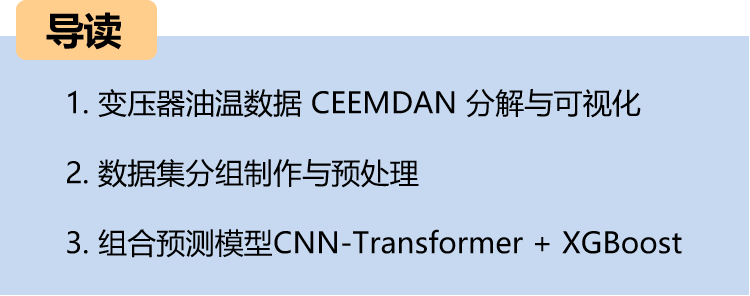
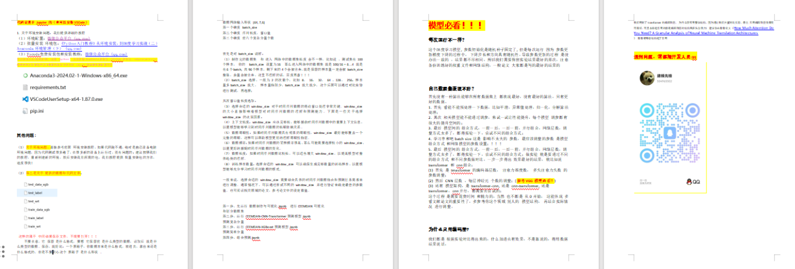
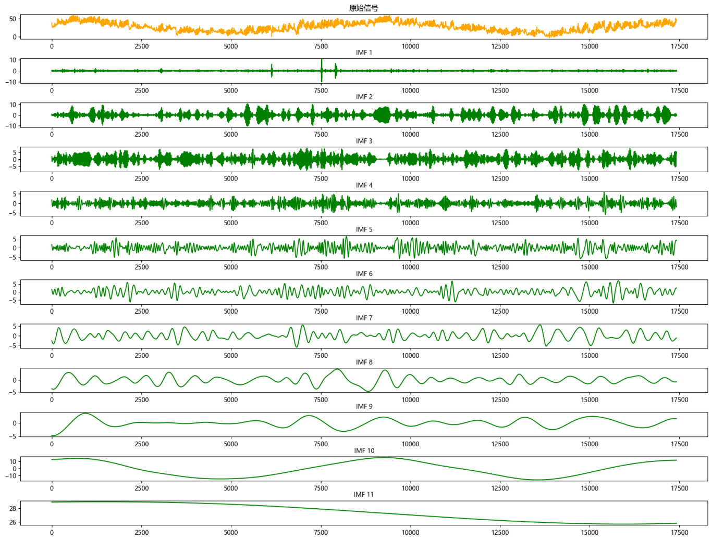
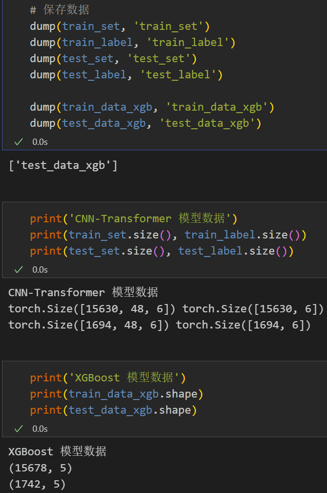
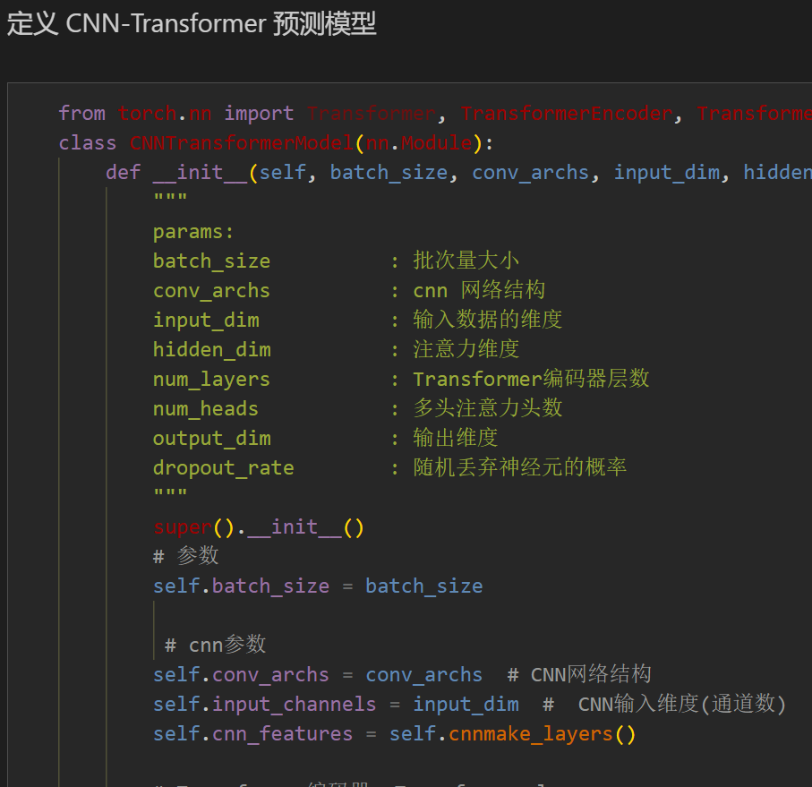
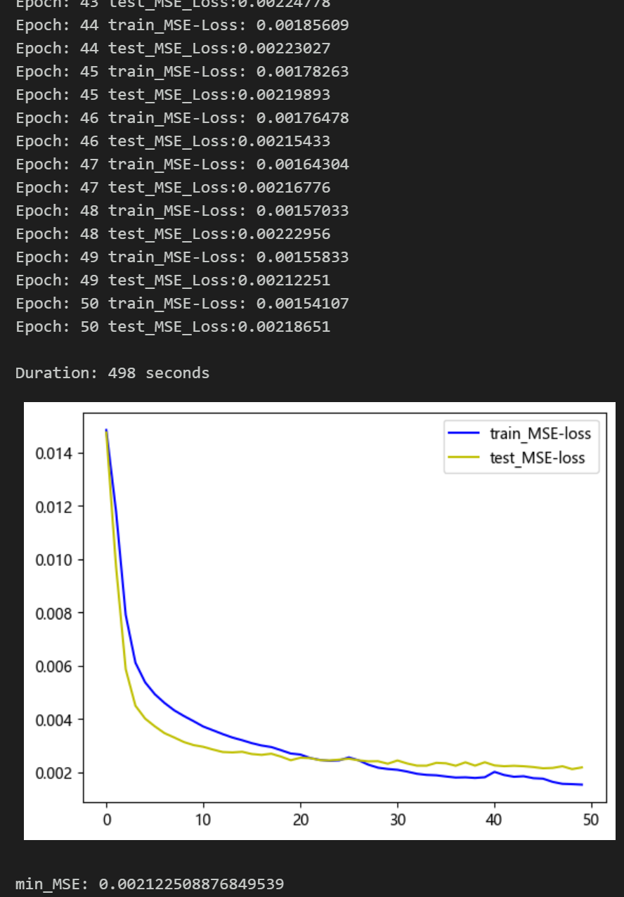
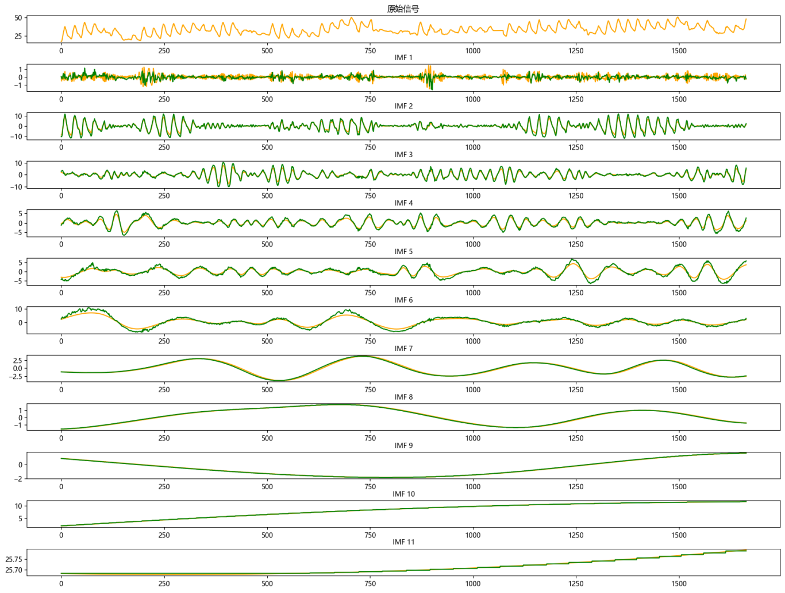
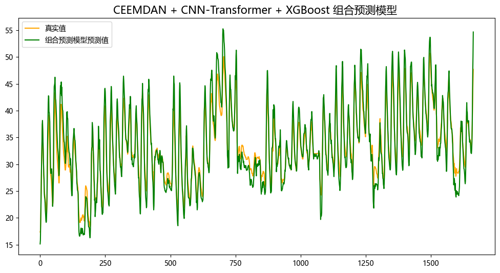
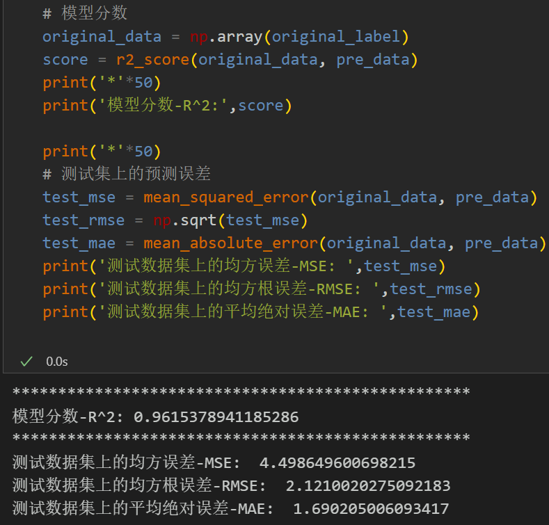
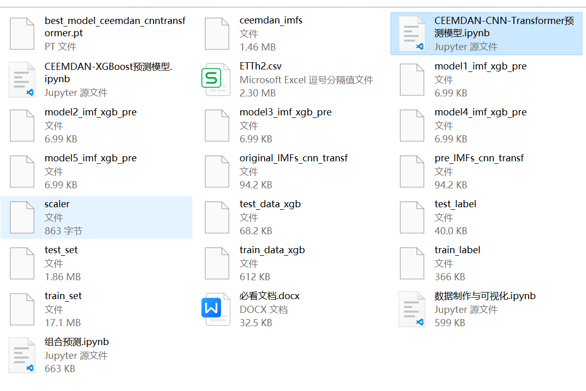

# CEEMDAN + Combination Prediction Model (CNN-Transformer + XGBoost)

CEEMDAN + Combination Prediction Model (CNN-Transformer + XGBoost)
This product includes the power transformer dataset, wind speed dataset, and a preprocessed dataset and label set generated by CEEMDAN decomposition. The corresponding code can be run, as well as examples of CEEMDAN decomposition.
The CNN-Transformer + XGBoost model has smaller MSE and MAE, with particularly noticeable results.
The code for data preprocessing with CEEMDAN and the complete CNN-Transformer prediction code, XGBoost prediction model code, and visualization code are included.
Environment: Python 3.9
Innovation 1: By using the CNN convolutional pooling layer to reduce the sequence length and increase the data dimension, then feeding it into the Transformer encoder layer for feature enhancement, utilizing multi-head attention and its superior network structure to fuse spatial and temporal features;
Innovation 2: By splitting the components decomposed by CEEMDAN algorithm through sample entropy calculation, and then separately predicting them through the CNN-Transformer model and XGBoost model to achieve precise predictions.
\tNote: This product also includes accompanying model explanations and parameter tuning guidance!
Preface
\tThis article introduces a comprehensive application method of the comprehensive ensemble empirical mode decomposition (CEEMDAN) and combination prediction models (CNN-Transformer + XGBoost) based on the previously introduced power transformer dataset (Appendix for dataset). The purpose is to improve the predictive performance of time series data. The core of this method is to use the CEEMDAN algorithm to decompose the time series, followed by modeling the decomposed data using the CNN-Transformer model and XGBoost model, and finally integrating the predictions of both methods.
\tFor more detailed introductions to the power transformer dataset, please refer to the following document:
Introduction to the Power Transformer Dataset and Preprocessing
1. Data Decomposition and Visualization of CEEMDAN for Power Transformers
1.1 Import data
1.2 CEEMDAN Decomposition
Based on the decomposition results, CEEMDAN has been divided into a total of 11 components. Subsequently, the sample entropy values for each component were calculated to analyze. Sample entropy is a method used to measure the complexity of sequences, which can be evaluated by calculating the uncertainty within the sequence. The higher the sample entropy, the greater the complexity of the sequence.
We roughly predict the CNN-Transformer model by taking the first six high-sample entropy complex components as input, and the XGBoost model by taking the last five low-sample entropy simple components as input.
2. Data Set Creation and Preprocessing
2.1 Dataset division
Training set and test set are divided into 9:1 ratio, then further divided into 6:5 ratio for component data.
When dealing with LSTF issues, selecting the appropriate window size is crucial. The right choice of window size can help the model better capture patterns and features within time series. To extract longer dependencies for modeling in sequence, this paper increases the window size to 48 and employs the CCEMDAN-CNN-Transformer model to fully extract feature information from the first six components of the sequence.
Save data in batches for predictions by different models.
\t  
3. Combination Prediction Model Based on CEEMDAN
3.1 Define the CNN-Transformer network model
\t  
3.2 Set parameters and train the model
50 epochs, MSE is 0.002122, the prediction effect of CNN-Transformer is significant. The model can fully extract the temporal and spatial features of time series, has a fast convergence speed, superior performance, high prediction accuracy, and further improve the model's predictive performance by appropriately adjusting the model parameters.
\tNote: Adjust parameters.
1. Adjust the number of CNN layers and the dimensions per layer to fine-tune learning rates;
2. Adjust the number of Transformer encoder layers, multi-head attention heads, and attention dimensions to increase more epochs (be cautious to prevent overfitting);
3. Change the sliding window length (set an appropriate window length);
4. Save training results and prediction data for later combination with the results of the XGBoost model.
5. Prediction based on XGBoost Model:
   - Tutorial for traditional machine learning models XGBoost follows:
     - Superior predictive algorithm: XGBoost prediction model
   - Data loading, grouping training and testing data into 5 components, splitting into 5 datasets
   - 
   - Save the predicted data, other components' predictions follow the above process, retaining the final model result.
6. Results Visualization and Model Evaluation:
   - 6.1 Visualization of component prediction results
   - 6.2 Visualization of combined prediction results
   - 6.3 Model evaluation
   - From the component prediction results, it is evident that the first 6 complex components fit well under the CNN-Transformer prediction model, while the last 5 simple components fit exceptionally well under the XGBoost model's prediction, showing significant combined prediction effects!
7. Previously interesting content:
   - Time series forecasting: Analysis and comparison of LSTM, ARIMA, Holt-Winters, SARIMA models
   - Wind speed forecasting (I) - Introduction and preprocessing of the dataset
   - Wind speed forecasting (II) - EMD-LSTM model based on Pytorch
   - Wind speed forecasting (III) - EMD-LSTM-Attention model
   - Wind speed forecasting (IV) - EMD-Transformer model based on Pytorch
   - Wind speed forecasting (V) - EMD-CNN-LSTM model based on Pytorch
   - Wind speed forecasting (VI) - EMD-CNN-GRU parallel model based on Pytorch
CEEMDAN + Combination Prediction Model (BiLSTM-Attention + ARIMA)
CEEMDAN + Combination Prediction Model (CNN-LSTM + ARIMA)
CEEMDAN + Combination Prediction Model (Transformer - BiLSTM + ARIMA)
CEEMDAN + Combination Prediction Model (CNN-Transformer + ARIMA)
Multi-Feature Variable Sequence Forecasting (I) - CNN-LSTM Wind Speed Forecasting Model
Multi-Feature Variable Sequence Forecasting (II) - CNN-LSTM-Attention Wind Speed Forecasting Model
Multi-Feature Variable Sequence Forecasting (III) - CNN-Transformer Wind Speed Forecasting Model
Multi-Feature Variable Sequence Forecasting (IV) Transformer-BiLSTM Wind Speed Forecasting Model
Multi-Feature Variable Sequence Forecasting (V) CEEMDAN+CNN-LSTM Wind Speed Forecasting Model
Multi-Feature Variable Sequence Forecasting (VI) CEEMDAN+CNN-Transformer Wind Speed Forecasting Model
Prediction Model Based on the Particle Swarm Optimization Algorithm SSA - CEEMDAN-BiLSTM-Attention
Prediction Model Based on the Particle Swarm Optimization Algorithm SSA - CEEMDAN-Transformer-BiGRU
Superior Prediction Model: Secondary Decomposition-Combination Prediction
Multi-Feature Variable Sequence Forecasting (VII) CEEMDAN+Transformer-BiLSTM Forecasting Model
Multi-Feature Variable Sequence Forecasting (VIII) Prediction Model Based on the Particle Swarm Optimization Algorithm for CEEMDAN-SSA-BiLSTM
Multi-Feature Variable Sequence Forecasting (11) Prediction Model Based on Pytorch's TCN-GRU
VMD + CEEMDAN Secondary Decomposition, CNN-LSTM Forecasting Model
VMD + CEEMDAN Secondary Decomposition, CNN-Transformer Prediction Model
VMD + CEEMDAN Secondary Decomposition, Transformer-BiGRU Prediction Model
Prediction Model Based on the Particle Swarm Optimization Algorithm SSA - Complete Code Kit
Introduction to Electric Power Transformer Data Set and Preprocessing
SCI 1 Category Highly Innovative Prediction Model!
END

## Images

<!-- PAYMENT_BLOCK -->

## Get this dataset

- Payment link (Stripe): [Buy now](https://buy.stripe.com/3cs8yP7sY87d0vu9AB)
- Payment QR code: 

<!-- /PAYMENT_BLOCK -->
